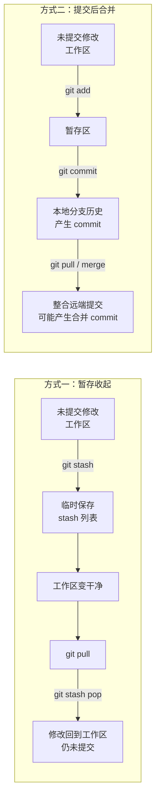

# 问答 13：使用 `git stash` 暂存未提交修改

## 提问

如果暂时不想提交本地修改，但又需要先运行 `git pull`，怎样临时收起这些修改，之后再恢复？

## 回答

可以使用 `git stash` 暂时保存未提交的修改，让工作区恢复干净，然后拉取远端更新，再恢复之前收起的修改：

```bash
git stash push -m "暂存我的修改"
git pull
git stash pop
```

`git stash pop` 会恢复修改，并在成功后从 stash 列表中移除这条记录。如果希望恢复后仍保留记录，可以使用 `git stash apply`。恢复时也可能发生冲突，需要手动处理。

默认情况下，未跟踪的新文件不会一起收起。如需包含它们，可以使用 `git stash push -u`。

## 注释

`git stash` 保存本地工作区和暂存区的当前状态，方便暂时回到干净的工作区。它不会创建普通提交，也不会把修改推送到远端。[Git stash 文档](https://git-scm.com/docs/git-stash)

## 补充问答：默认 `git stash` 收起哪些修改

### 提问

默认情况下，`git stash` 是否只收起已经暂存的文件，而不收起尚未运行 `git add` 的修改？

### 回答

不是。默认的 `git stash` 会收起已被 Git 跟踪文件上的已暂存和未暂存修改，不要求先运行 `git add`。

### 注释

未跟踪的新文件默认不会被收起。需要连同这类文件一起保存时，可以使用 `git stash push -u`。

## 补充问答：stash 恢复冲突与提交后合并

### 提问

使用 `git stash` 收起修改后，恢复时是否也可能发生冲突？这与先提交修改、再通过 `merge` 整合有什么区别？

### 回答

`git stash pop` 或 `git stash apply` 恢复修改时也可能发生冲突。如果收起修改后，当前分支上的同一部分代码又发生了变化，Git 可能无法自动整合两边的内容。发生冲突时，`git stash pop` 会保留 stash 记录，直到成功恢复或手动清理。[Git stash 文档](https://git-scm.com/docs/git-stash)

两种做法的主要区别在于本地修改的保存方式：

| 做法 | 本地修改的保存方式 | 恢复或整合方式 |
|---|---|---|
| `git stash` | 临时收起未提交的修改，使工作区变干净 | 之后将修改重新应用到当前工作区 |
| `git commit` 后 `merge` | 将修改保存为当前分支中的正式提交 | 合并两个分支的提交历史 |

### 注释

两种方式都可能发生冲突，因为 Git 都需要整合不同版本的文件内容。stash 适合暂时收起未提交的工作；提交后再 merge 会把修改保存在分支历史中。[Git merge 文档](https://git-scm.com/docs/git-merge)

## 补充问答：解决 stash 冲突后是否产生提交

### 提问

手动解决 `git stash pop` 或 `git stash apply` 产生的冲突后，Git 会自动创建提交记录吗？

### 回答

不会。解决冲突后的内容会留在工作区或暂存区，不会自动成为当前分支中的普通 commit。运行 `git status` 可以查看文件状态。若要把结果记录到当前分支，需要运行 `git add`，再运行 `git commit`。

### 注释

如果 `git stash pop` 因冲突未能完成，stash 记录会保留。冲突解决并确认不再需要该记录后，可以再清理它。[Git stash 文档](https://git-scm.com/docs/git-stash)

## 补充问答：merge 是否自动创建提交

### 提问

本地修改已经提交后，再使用 `git merge` 整合远端提交，Git 是否会自动创建提交记录？

### 回答

如果本地分支和远端分支各自包含新的提交，`git merge` 成功整合后，Git 通常会自动创建一个合并提交，记录两边历史的汇合。[Git merge 文档](https://git-scm.com/docs/git-merge)

如果本地分支只是落后于远端，Git 可以通过快进移动本地分支指针，不会额外创建合并提交。

如果合并发生冲突，Git 会暂停操作。解决冲突后，需要运行 `git add`，再运行 `git commit` 或 `git merge --continue` 完成合并。

### 注释

当本地和远端分支各自有提交时，合并提交会记录两边的历史；stash 恢复冲突只会把解决后的内容留在工作区或暂存区，不会自动创建当前分支的普通提交。

## stash 与 commit 流程对比



### 文字说明

`git stash` 会临时保存未提交的修改，并让工作区恢复干净。拉取远端更新后，使用 `git stash pop` 恢复修改。恢复后的修改仍未提交，需要之后再决定是否提交。

使用 commit 时，先运行 `git add` 将修改放入暂存区，再运行 `git commit` 将修改记录到本地分支历史中。之后通过 `git pull` 或 `git merge` 整合远端更新。如果本地和远端分支各自有新提交，合并通常会产生一个合并提交。

这两种方式都可能在整合改动时遇到冲突。

## 补充问答：stash 与 commit 的适用情景

### 提问

`git stash` 和先 `git commit` 再整合远端更新，分别适用于什么情景？

### 回答

当修改尚未完成，暂时不想创建提交，但需要切换分支、拉取更新或处理其他任务时，可以使用 `git stash` 临时收起修改。之后再用 `git stash pop` 恢复。stash 保存在本地，不会作为普通提交推送给其他人。

当修改已经达到一个可以记录的阶段，并希望将它保存在分支历史中时，可以先运行 `git add` 和 `git commit`，再通过 `git pull` 或 `git merge` 整合远端更新。之后可以推送本地提交与他人分享。

### 注释

简单来说，临时中断工作时可以用 stash；想正式记录一项修改时可以 commit。两种方式在整合改动时都可能遇到冲突。
